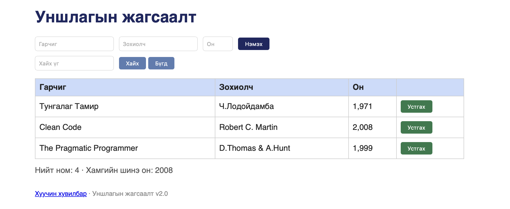

# BUG-03: «Нийт ном» тоолуур хүснэгтэд буй номын тооноос нэгээр их харагддаг

Орчин:  Уншлагын жагсаалт v2.0, Safari 26.5.2, macOS, 2026-11-26
Урьдчилсан нөхцөл: node app.js-ийг шинээр асаасан (анхны 3 ном)

## Дахин гаргах алхам
1. Терминалд `node app.js` ажиллуулна.
2. Safari дээр http://localhost:3000 нээнэ.
3. Хүснэгтийн мөрийн тоог тоолно (3), доорх «Нийт ном» тоолуурыг уншина.

Хүлээгдэж байсан: «Нийт ном» тоолуур хүснэгтэд буй номын тоотой тэнцүү.
Бодит үр дүн:     3 мөр байхад «Нийт ном: 4». Ном нэмэх тусам зөрүү хэвээр: 9 мөр дээр 10, 12 мөр дээр 13.

Ноцтой байдал: Major. Хуудас бүр ачаалах бүрт буруу тоо харагдах ба хэрэглэгчийн мэдээллийн үнэн зөв байдалд нөлөөлнө.
Хавсралт:      screenshots/bug-03.png
Олдсон аялал:  Fed-Ex (өгөгдлийн зам: ном нэмэх → хүснэгт → тоолуур)

## Зураг

