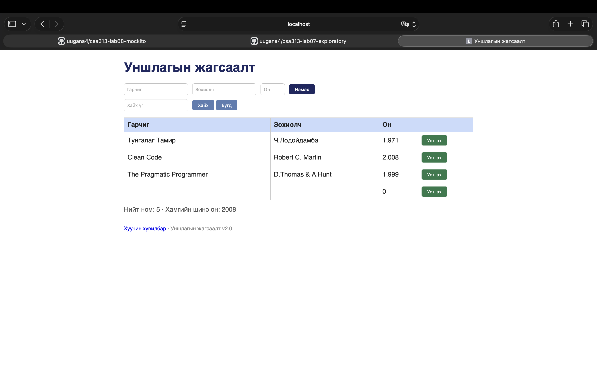

# BUG-04: Гурван талбарыг хоосон орхиж «Нэмэх» дарахад хоосон ном нэмэгддэг

Орчин:  Уншлагын жагсаалт v2.0, Safari 26.5.2, macOS, 2026-11-26
Урьдчилсан нөхцөл: node app.js-ийг шинээр асаасан (анхны 3 ном)

## Дахин гаргах алхам
1. http://localhost:3000 нээнэ.
2. Гарчиг, Зохиолч, Он гурвыг хоосон орхино.
3. «Нэмэх» товчийг дарна.

Хүлээгдэж байсан: «Ном нэмэхэд Гарчиг, Зохиолч, Он гурван талбар бүгд заавал бөглөгдсөн байх ёстой; дутуу бол ном нэмэгдэхгүй, ойлгомжтой алдааны мессеж харагдана.»
Бодит үр дүн:     «Ном нэмэгдлээ» мессеж гарч, хоосон гарчиг, хоосон зохиолч, он 0 гэсэн 4 дэх мөр нэмэгдэнэ. Алдааны мессеж гарахгүй. «Нийт ном: 5» (BUG-03-ын зөрүүтэй).

Ноцтой байдал: Major. Шалгалтгүйгээр хоосон өгөгдөл жагсаалтад орж, мэдээллийн чанарыг бууруулна.
Хавсралт:      screenshots/bug-04.png
Олдсон аялал:  Couch Potato (хоосон оролт)

## Зураг

