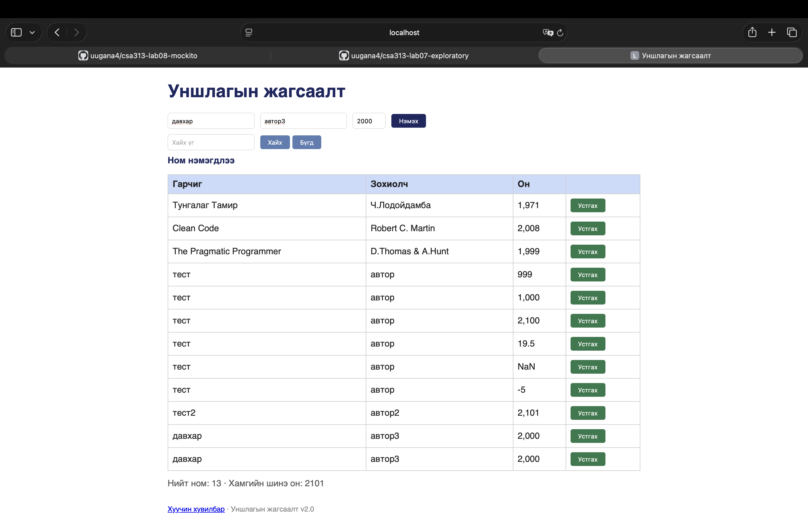

# BUG-07: Он талбар 1000-2100 хүрээнээс гадуур болон бүхэл биш утга хүлээн авдаг

Орчин:  Уншлагын жагсаалт v2.0, Safari 26.5.2, macOS, 2026-11-26
Урьдчилсан нөхцөл: node app.js-ийг шинээр асаасан (анхны 3 ном)

## Дахин гаргах алхам
1. http://localhost:3000 нээнэ.
2. Гарчигт `тест`, Зохиолчид `автор` гэж бичээд Онд `999` оруулж «Нэмэх» дарна.
3. Онд ээлжлэн `19.5`, `abc`, `-5`, `2101` оруулж давтана.
4. Харьцуулалтад `1000` ба `2100`-г оруулна.

Хүлээгдэж байсан: «Он нь 1000-2100 хоорондох бүхэл тоо.» Хүрээнээс гадуур эсвэл бүхэл биш утгад ном нэмэгдэхгүй, алдааны мессеж гарна.
Бодит үр дүн:     999, 19.5, abc, -5, 2101 бүгдэд «Ном нэмэгдлээ» мессеж гарч мөр нэмэгдэнэ. `abc` нь хүснэгтэд «NaN» гэж харагдана. 1000 ба 2100 зөв нэмэгдэнэ.

Ноцтой байдал: Major. Буруу өгөгдөл (NaN, сөрөг он) хадгалагдаж, «Хамгийн шинэ он» зэрэг тооцоонд нөлөөлнө.
Хавсралт:      screenshots/bug-07.png
Олдсон аялал:  Couch Potato (хилийн болон буруу оролт)

## Скриншот

