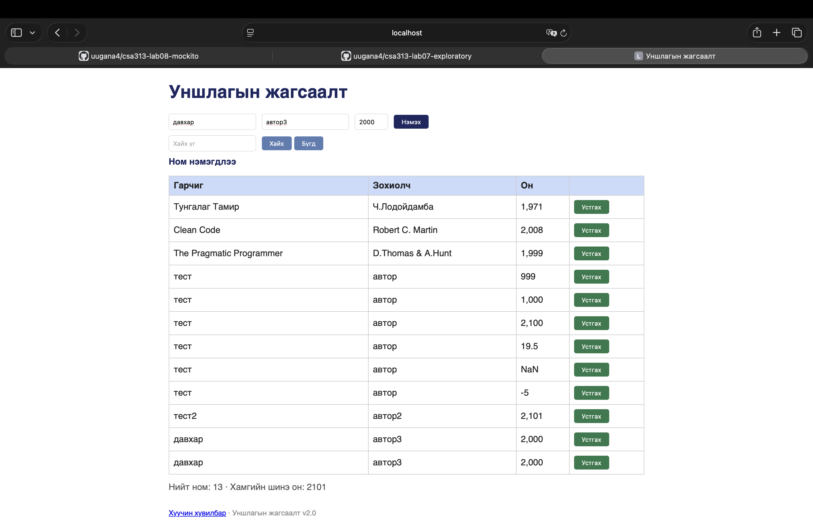

# BUG-08: Ижил гарчиг, зохиолчтой ном давхардаж нэмэгддэг

Орчин:  Уншлагын жагсаалт v2.0, Safari 26.5.2, macOS, 2026-11-26
Урьдчилсан нөхцөл: node app.js-ийг шинээр асаасан (анхны 3 ном)

## Дахин гаргах алхам
1. http://localhost:3000 нээнэ.
2. Гарчигт `давхар`, Зохиолчид `автор3`, Онд `2000` бичээд «Нэмэх» дарна.
3. Яг ижил утгыг дахин оруулж «Нэмэх» дарна.

Хүлээгдэж байсан: «Ижил гарчиг, зохиолчтой ном давхардуулж нэмэгдэхгүй.»
Бодит үр дүн:     Хоёр дахь удаад ч «Ном нэмэгдлээ» гарч, хүснэгтэд ижил хоёр мөр харагдана. Давхардлын алдааны мессеж гарахгүй.

Ноцтой байдал: Major. Нэг ном хоёр удаа жагсаалтад орж, тоо ба хайлтын үр дүнг гажуудуулна.
Хавсралт:      screenshots/bug-08.png
Олдсон аялал:  Fed-Ex (өгөгдлийн зам)

## Зураг

