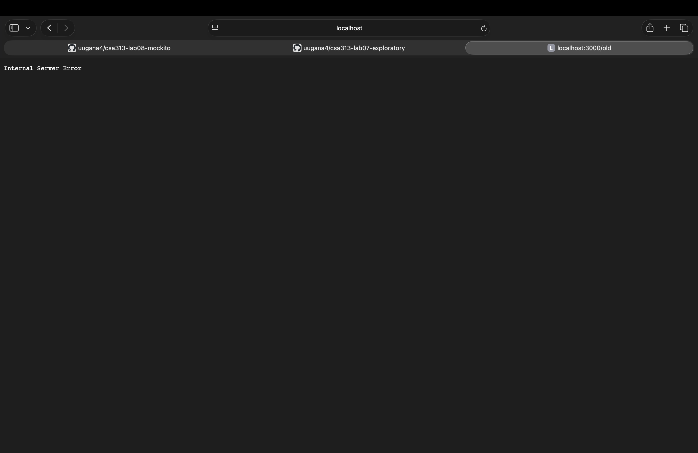

# BUG-10: «Хуучин хувилбар» холбоос 500 Internal Server Error буцаадаг

Орчин:  Уншлагын жагсаалт v2.0, Safari 26.5.2, curl, macOS, 2026-11-26
Урьдчилсан нөхцөл: node app.js-ийг шинээр асаасан (анхны 3 ном)

## Дахин гаргах алхам
1. http://localhost:3000 нээнэ.
2. Хуудасны доод талын «Хуучин хувилбар» холбоосыг (href="/old") дарна.
3. API түвшинд: `curl -i localhost:3000/old`.

Хүлээгдэж байсан: «Бүх хуудас, линк ажиллана.»
Бодит үр дүн:     HTTP/1.1 500 Internal Server Error, хариуны бие «Internal Server Error» (энгийн текст). Хөтөч дээр зөвхөн энэ текст харагдана.

Ноцтой байдал: Major. Аппын харагдах холбоос ажиллахгүй, хэрэглэгч гарц олдохгүй.
Хавсралт:      screenshots/bug-10.png · evidence/bug-10-curl.txt
Олдсон аялал:  Supermodel (GUI) ба Saboteur (curl)

## Зураг

